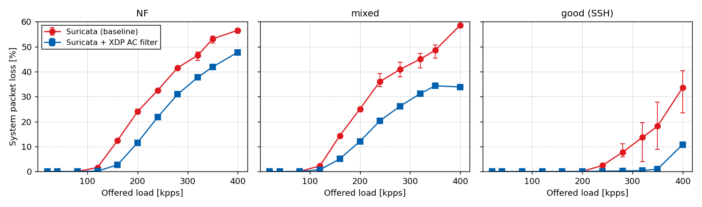

# Exploiting Rule Skewness: an eBPF/XDP Prefilter for Signature-Based IDS

Code, configurations and performance data for the paper

> M. Federico, A. Tulumello, G. Belocchi, G. Bianchi,
> **"Exploiting Rule Skewness: An eBPF/XDP Prefilter for Signature-Based Intrusion Detection"**,
> IEEE CloudNet 2026.

An XDP program scans each packet at the NIC driver hook against a compact *blocklist*
of patterns derived from the active Suricata ruleset and from a traffic profile.
A monitored packet that contains none of them cannot trigger any signature, so it is
diverted before it reaches the IDS. Everything else goes to an **unmodified Suricata**
(AF_PACKET). Pattern matching runs in a kernel module that exposes a scalar
Aho-Corasick DFA (Hopcroft-minimised, 16-bit states, n-gram prefilter) to BPF as a kfunc.

```
 pcap + ruleset ──► analyzer/ ──► patterns.hs ──► kernel/ac/ac_build ──► <capture>.acdb
   (offline)       least-frequent content per rule                       │ configfs
                                                                          ▼
 NIC ──► XDP xdp_prog_ac.o ──► kfunc bpf_xdp_ac_scan (xdp_ac_module.ko)
           │ {proto,port} ∉ app_map, SYN/FIN/RST, no payload ──► XDP_PASS ──► Suricata
           │ blocklist match                                  ──► XDP_PASS ──► Suricata
           └ no match                                         ──► XDP_DROP (diverted)
```

## Repository layout

| Path | Content |
|---|---|
| `config.env` | **Testbed settings: interfaces, IPs, PCI address, paths.** This is the only file to edit on a new machine. |
| `analyzer/` | Offline Analyzer (C + Python). Finds the dominant protocol/port, filters the rules, and picks each rule's least-frequent `content` in the pcap. |
| `kernel/ac/` | **Pattern Engine + XDP Filter**: `xdp_ac_module.c` (kfunc, configfs `/sys/kernel/config/ac`), `xdp_prog_ac.c`, `ac_build.c` (ACDB compiler), userspace self-test and benchmarks. |
| `kernel/hs_kfunc/` | In-kernel **Hyperscan** kfunc module (REX-style, on [G-Core/linux-regex-module](https://github.com/G-Core/linux-regex-module)). Used for the engine-selection microbenchmark in the Discussion. |
| `sim/` | `sim_ac.c`, a bit-exact offline replay of the XDP verdict, and `run_pipeline.sh` (pcap + rules → ACDB). |
| `patterns/` | The selected patterns of the paper (`NF.hs`, `mixed.hs`, `good.hs`). |
| `rulesets/` | The `suricata-update` snapshot used in the paper (2024-11-12, xz), the sid:rev lists Suricata loaded per capture, and checksums. |
| `suricata/` | Suricata configuration used in all runs. |
| `eval/` | Testbed orchestration: `run_experiment.py` (DUT), `slave.py` + `traffic/pcap_replay.c` (DPDK generator), `hs_timing_test.py`, and the YAML configs of every paper experiment. |
| `results/` | Raw per-run outputs of the paper experiments, CSV summaries, the scripts that extract them, and the figures. See [`results/README.md`](results/README.md). |
| `datasets/` | How to obtain the three captures (not redistributed). |

## Results at a glance

Detection equivalence: alerts on a loss-free single pass at 10 kpps (`results/data/runs.csv`, tests `lowrate4_*`).

| | NF | mixed | good |
|---|---|---|---|
| Suricata (baseline) | 248 | 362 | 0 |
| Suricata + XDP filter | 252 | 362 | 0 |
| Packets removed by the filter | 39.2 % | 28.1 % | 34.7 % |
| Blocklist patterns / DFA states | 18 757 / 55 568 | 18 628 / 56 114 | 2 292 / 9 156 |

On NF the 4 extra alerts come from Suricata's 4 KiB HTTP body-inspection window. The
filter compacts the stream, so the window reaches content deeper in the file. With the
limit at 8 KiB the two alert sets are identical (paper §IV-B).

System loss (`rx_missed + AF_PACKET drops` / sent) with the DPDK replayer, mean of 3 runs (`results/data/summary.csv`):

| offered load | NF baseline | NF filter | mixed baseline | mixed filter | good baseline | good filter |
|---|---|---|---|---|---|---|
| 120 kpps | 1.6 % | 0.2 % | 2.2 % | 0.7 % | 0.0 % | 0.0 % |
| 200 kpps | 24.0 % | 11.6 % | 25.1 % | 12.1 % | 0.1 % | 0.0 % |
| 400 kpps | 56.5 % | 47.7 % | 58.6 % | 33.9 % | 33.5 % | 10.8 % |



`python3 results/plot_figures.py` rebuilds every figure from the CSVs.

## Requirements

Values in parentheses are the versions used for the paper.

**DUT (device under test)**
- Linux with BTF and kfunc support, kernel ≥ 6.x (6.8.12), plus headers for the running kernel
- clang/LLVM (18.1), gcc (13.3), bpftool (7.4), libbpf headers (`libbpf-dev`), libpcap-dev, ethtool
- Suricata **8.0.0**, unmodified, built with AF_PACKET support, at `SURICATA_BIN`
- Python 3 with `pyyaml`, plus `matplotlib` for the figures
- Hyperscan module only: cmake, ragel, boost (to build `hscollider`), and `libhyperscan-dev` for `analyzer/pcap_hs_scan`

**Traffic generator (slave)**
- DPDK (`pkg-config libdpdk`) with a NIC bound to it, tcpreplay (4.4.4), Python 3

**Testbed used in the paper:** two servers back to back on Mellanox mlx5 NICs plus a
separate management network. The DUT is a 4-vCPU Xeon (Skylake) VM running Ubuntu 24.04,
with 4 RX queues, an 8192-entry RX ring and a fixed RSS key (`eval/run_experiment.py`).

## Quick start

### 0. Configure the machine
```bash
vim config.env          # DUT_IFACE, DUT_MGMT_IFACE, IPs, SLAVE_*, SURICATA_BIN
```

### 1. Rebuild the paper artefacts (no pcap needed)
```bash
bash scripts/build_paper_dbs.sh
# -> build/{NF,mixed,good}/filtered.rules   (rules Suricata loads)
#    build/{NF,mixed,good}/<capture>.acdb   (blocklist DBs)
# checked against rulesets/SHA256SUMS: byte-identical to the paper's
```

### 2. Build and deploy the filter
```bash
make -C kernel/ac                      # xdp_ac_module.ko, xdp_prog_ac.o, ac_build, tools
./kernel/ac/ac_selftest build/NF/NF.acdb   # userspace check of prefilter + DFA

bash kernel/ac/setup_ac.sh build/NF/NF.acdb 6 80   # insmod, configfs upload, XDP attach, app_map tcp/80
sudo bpftool map dump pinned /sys/fs/bpf/ac_maps/xdp_drop_cnt   # packets diverted
bash kernel/ac/teardown_ac.sh
```

### 3. Reproduce an experiment
```bash
# on the slave (clone the repo there too, with its own config.env)
make -C eval/traffic                   # DPDK pcap_replay -> eval/traffic/build/pcap_replay
python3 eval/slave.py                  # listens on SLAVE_MGMT_IP:SLAVE_PORT

# on the DUT
python3 eval/test_connectivity.py eval/test_case/highrate_mixed_dpdk.yaml
python3 eval/run_experiment.py eval/test_case/highrate_mixed_dpdk.yaml
python3 results/extract.py --tests highrate_mixed_dpdk
python3 results/plot_figures.py
```
Run one experiment at a time, in the foreground. Orphaned masters running in the
background interleave runs on the slave.

| Paper item | Config(s) |
|---|---|
| Table "alerts", offload % | `lowrate4_{NF,mixed,good}` (10 kpps single pass) |
| Fig. system loss | `highrate_{NF,mixed,good}_dpdk` |
| Fig. misprediction | `mispredict_good_on_mixed_dpdk` (baseline: `highrate_mixed_dpdk`) |
| Misprediction, tcpreplay | `mispredict_good_on_mixed` (baseline: `lowrate4_mixed`) |
| Hyperscan in-kernel microbenchmark | `eval/hs_timing_test.py` (see below) |

### 4. Build the databases from scratch (new traffic / ruleset)
```bash
bash sim/run_pipeline.sh mycapture datasets/pcap/my.pcap /var/lib/suricata/rules/suricata.rules
# -> build/mycapture/{filtered.rules, patterns.hs, mycapture.acdb, proto_meta.txt, sim_report.txt}
```
`proto_meta.txt` gives the port to put in `filter_port`. `sim_report.txt` predicts the
offload the live filter will achieve.

### 5. Hyperscan kfunc module (microbenchmark)
```bash
bash kernel/hs_kfunc/fetch_linux_regex_module.sh      # clone at the pinned commit + local patch
(cd kernel/hs_kfunc/linux-regex-module && cmake -B build -DCMAKE_BUILD_TYPE=Release && make -C build -j hscollider)
make -C kernel/hs_kfunc && make -C kernel/hs_kfunc bpf
sudo insmod kernel/hs_kfunc/xdp_regex_module.ko bench=1
bash kernel/hs_kfunc/init.sh patterns/mixed.hs         # -> build/hs/mixed/*.db, policy cattivi id 4321
sudo rmmod xdp_regex_module
python3 eval/hs_timing_test.py                         # loads the module itself, writes results/raw/hs_microbench
python3 results/extract_hs_microbench.py
```

## Moving to a new machine: checklist
1. Edit `config.env`: interface names (`ip -br link`), IPs, the slave's DPDK PCI address (`dpdk-devbind.py -s`), and the Suricata path.
2. Install the requirements, then run `make -C kernel/ac` against the new kernel.
3. Run `bash scripts/build_paper_dbs.sh`.
4. Put the pcaps on the slave in `SLAVE_PCAP_DIR`. Rewrite their Ethernet addresses for the new NICs (`datasets/README.md`).
5. `HOME_NET` in `suricata/suricata-eval.yaml` covers RFC1918. Adjust it if the new traffic uses other ranges.

## Notes
- Code comments and some design notes (`kernel/ac/*.md`, `analyzer/*.md`) are in Italian.
- `suricata/suricata-eval.yaml` declares its AF_PACKET section for interface `eth0`.
  Suricata therefore ran on the data NIC with AF_PACKET **defaults**, which is what the
  paper measured. It is kept unchanged on purpose, for reproducibility.
- The bypass database path ("buoni") is implemented only in the Hyperscan XDP program
  (`kernel/hs_kfunc/xdp_prog_kern_test.c`). The paper does not evaluate it.

## License
GPL-2.0 (see `LICENSE`). The kernel modules and BPF programs are GPL-only by necessity.
`eval/traffic/pcap_replay.c` is derived from DPDK sample code and keeps its BSD-3-Clause
header. `rulesets/` holds a snapshot of the Emerging Threats Open and Suricata rules,
which keep their original licenses.
